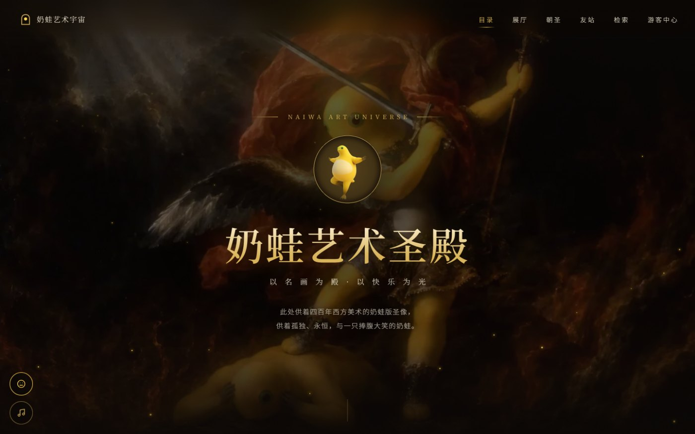
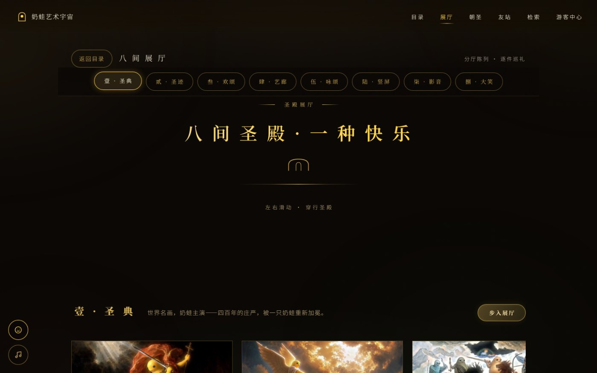
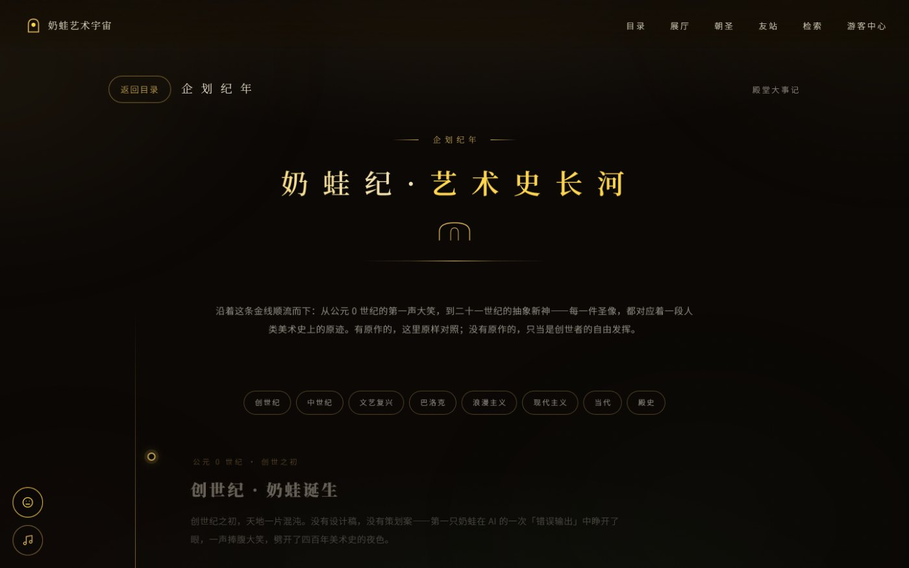
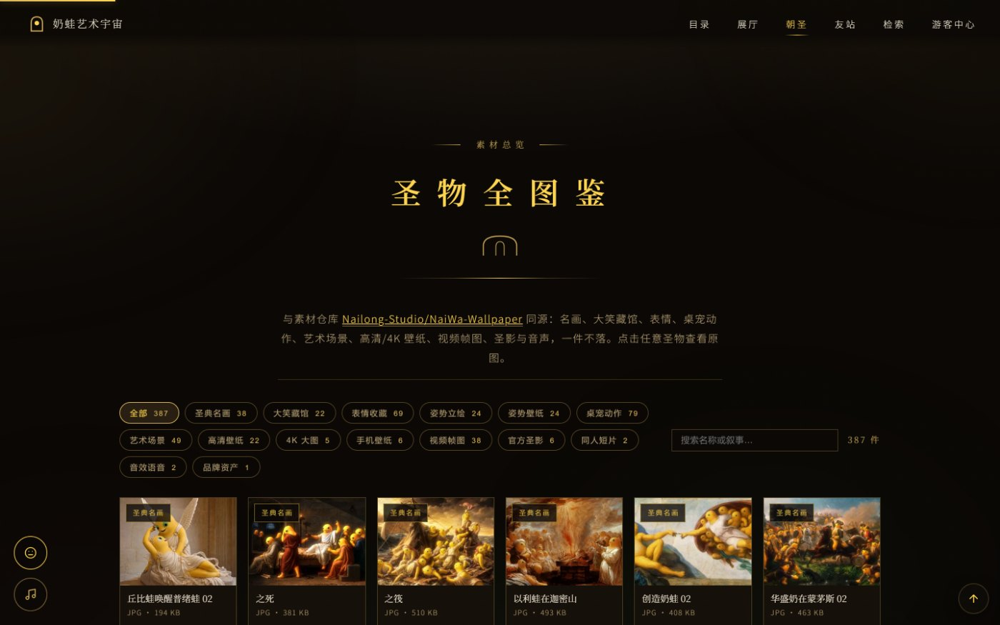
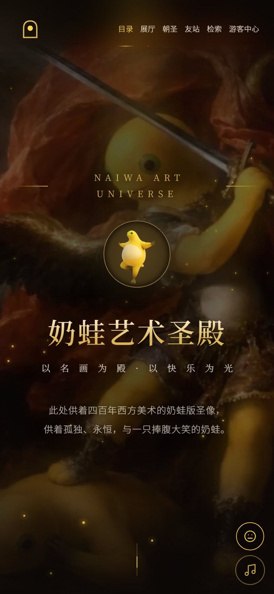

<div align="center">

# NaiWa Art Universe

**A digital museum where four centuries of Western painting get re-signed by a yellow frog.**

[](https://github.com/Nailong-Studio/NaiLoong-Universe/stargazers)
[](https://nailoong-universe.pages.dev/)
[](LICENSE)
[](#how-it-is-built)

[English](README.md) · [简体中文](README.zh-CN.md)



</div>

---

## What this is

An art museum you can open in a browser tab. Every permanent exhibit is a
Western painting — *The Last Judgment*, *The Creation of Adam*, *The Birth of
Venus* — with its central figures replaced by **奶蛙 (Naiwa)**, a round yellow
meme frog. There are eight galleries, a timeline of art history, a screening
room for short films, and a searchable vault of all 387 source assets.

It runs on static files. No framework, no bundler, no server, no database. Open
`docs/index.html` and the entire museum works — including offline, once the
service worker has cached the shell.

<table>
<tr>
<td width="50%"><br><sub><b>Galleries</b> — horizontal walk-through, one artwork per screen</sub></td>
<td width="50%"><br><sub><b>Timeline</b> — eight eras from Genesis to the abstract present</sub></td>
</tr>
<tr>
<td width="50%"><br><sub><b>Vault</b> — 387 assets, filterable and searchable</sub></td>
<td width="50%"><br><sub><b>Mobile</b> — immersive cards, safe-area aware</sub></td>
</tr>
</table>

## Take the tour

| | |
| --- | --- |
| **Live** | <https://nailoong-universe.pages.dev/> |
| **Mirror** | <https://nailong-studio.github.io/NaiLoong-Universe/> |
| **Asset warehouse** | [NaiWa-Wallpaper](https://github.com/Nailong-Studio/NaiWa-Wallpaper) — all originals, every file with a licence record |
| **Companion extension** | [NaiWa-NewTab](https://github.com/Nailong-Studio/NaiWa-NewTab) — the same art as a browser new-tab page |

Deep links work without JavaScript routing tricks:

```
#halls        all galleries          #hall-1 … #hall-8   one gallery
#relics       the asset vault        #chronicle          art history timeline
#search       keyword search         #visit              where to get the art
#w-NW-1-038   a single artwork       #about              visitor centre
```

## The eight galleries

| Hall | What hangs there |
| --- | --- |
| 壹 · 圣典 | Renaissance and Baroque masterpieces, frog-ified |
| 贰 · 圣迹 | Eight apocryphal scenes from the Naiwa gospel |
| 叁 · 欢颂 | Raw laughing portraits, straight from the source |
| 肆 · 艺廊 | Fan reworks — deep sea, wilderness, neon |
| 伍 · 咏颂 | Emote stickers for your group chats |
| 陆 · 竖屏 | Vertical crops sized for phones |
| 柒 · 影音 | Official short films |
| 捌 · 大笑藏馆 | Thirty laughing variants collected from across the web |

## How it is built

Single-file architecture, deliberately:

| Layer | Implementation |
| --- | --- |
| Markup + styles + script | Inlined in `docs/index.html` — one file, no build step |
| Routing | Hash-based multi-view router with deep links and `document.title` sync |
| Artwork data | `docs/data/collection.json`, exported from the page by `scripts/export_collection.py` |
| Asset manifest | Pulled from the wallpaper repository's `assets.json` |
| Vault generation | `scripts/build_vault.py` — the only thing allowed to write the vault block |
| Quality gate | `scripts/check_site.py` — one command, every check, used locally and in CI |
| Deployment | GitHub Actions → GitHub Pages, plus a Cloudflare Pages mirror |

**Why no framework?** The site is a museum, not an application. Content changes
far more often than behaviour, and the whole thing has to survive being opened
from a USB stick. A single HTML file with no dependencies is the smallest thing
that satisfies both.

### Quality gate

```bash
python scripts/check_site.py --manifest path/to/assets.json
```

It verifies, independently and with per-section reporting:

- every vault card matches the manifest, with no double-percent-encoding
- every referenced thumbnail exists
- the catalogue's halls, counts and ids are self-consistent
- `VERSION`, `CHANGELOG.md` and the service-worker cache agree
- HTML tags balance, and the inline script parses
- local references resolve, and a sample of outbound links returns real media

## Performance and accessibility

- Lazy loading with a 28 px LQIP placeholder, faded in on decode
- `content-visibility` on long lists; neighbouring artwork preloaded
- `prefers-reduced-motion` disables every animation, including the 3D gate
- Full keyboard path: skip link, focus trapping in the lightbox, `Esc` to exit,
  arrow keys to move between works
- `<noscript>` fallbacks so the page is readable with JavaScript disabled
- All decorative motion is CSS; no WebGL, no video autoplay, no tracking

## Repository layout

```
docs/index.html              the whole museum, one file
docs/data/collection.json    exported catalogue (187 works, 8 halls)
docs/assets/                 thumbnails, posters, self-hosted originals
docs/sw.js                   service worker; bump its cache with VERSION
scripts/build_vault.py       regenerates the 387-card vault from the manifest
scripts/export_collection.py exports and validates the catalogue
scripts/check_site.py        the quality gate
palette.json                 single source for every colour theme
themes/                      generated ports (VS Code, macOS, terminal…)
VERSIONING.md                SemVer rules and the release checklist
```

## Contributing

Read [CONTRIBUTING.md](CONTRIBUTING.md). Short version: fork, run the gate, keep
the commit subject imperative, do not hand-edit generated blocks.

## Licence

Code is [MIT](LICENSE). Naiwa is a fan-made derivative character; the original
character rights stay with their holders. Every asset in the warehouse carries
its own licence record, and anything that cannot be redistributed is excluded.

<div align="center">
<sub>NaiLoong Studio · the museum is free, the laughter is mandatory</sub>
</div>
